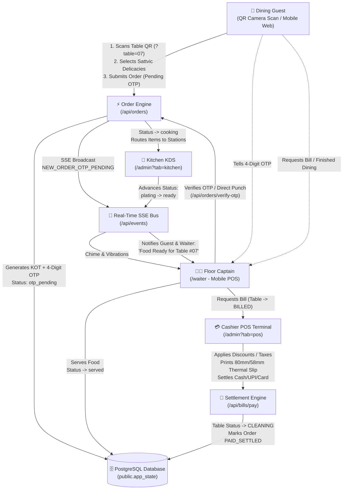
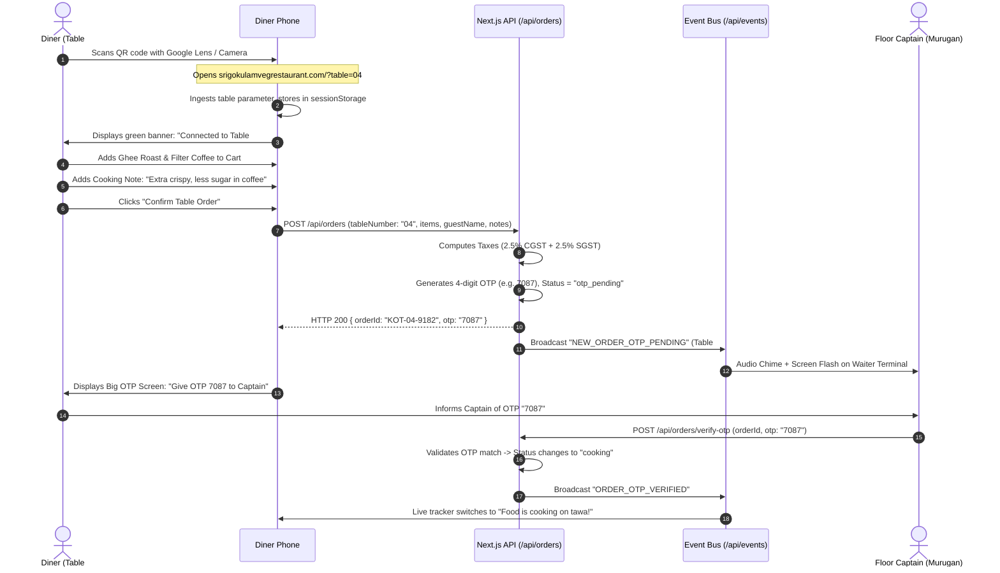
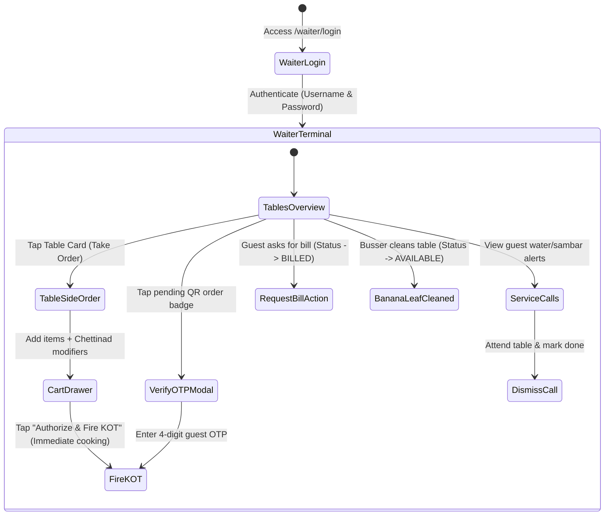
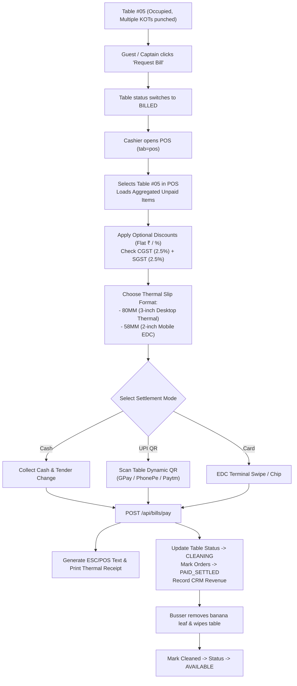
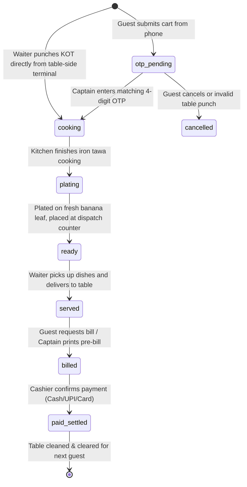
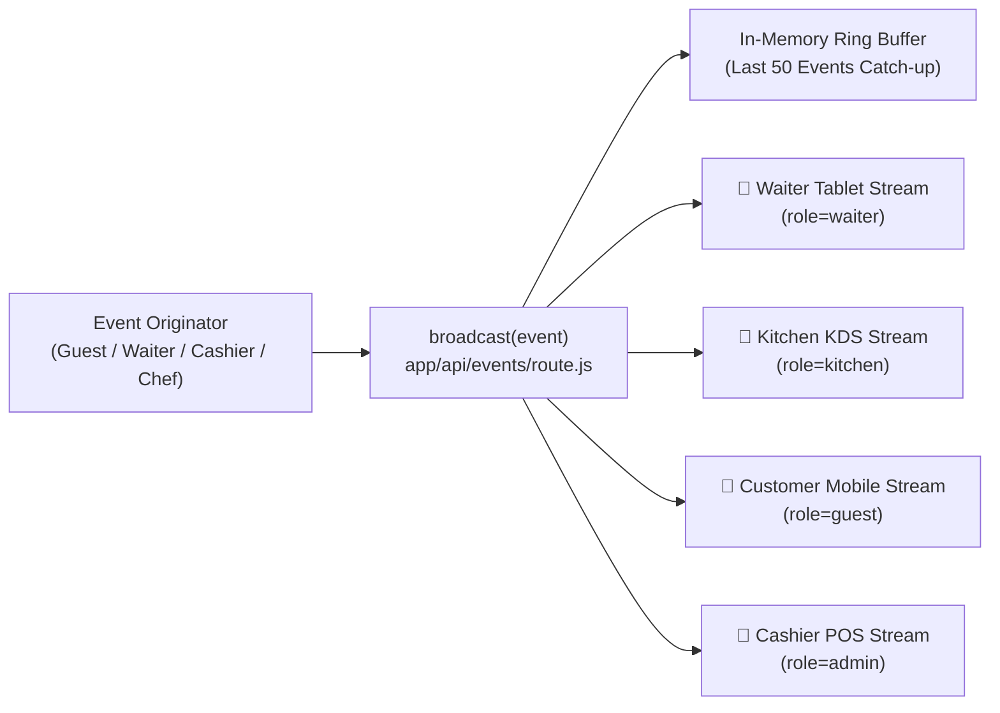
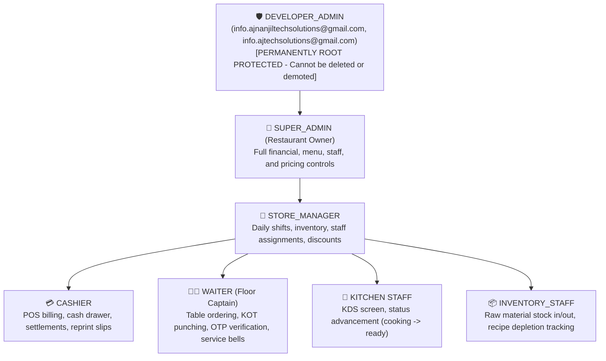

# Sri Gokulam Veg Restaurant — Complete System Workflow Specification

> **Authentic Chettinad Sattvic Culinary Heritage • Karaikudi, Tamil Nadu**  
> *Production Deployment Platform:* Railway (`srigokulamvegrestaurant.com`)  
> *Database Backend:* Supabase Managed PostgreSQL with Resilient Local Fallback Engine  
> *Frontend / Application Core:* Next.js App Router (React Server & Client Components, Web Audio API, Server-Sent Events)

---

## Executive Summary & System Architecture

The **Sri Gokulam Veg Restaurant Management Platform** is a full-stack, real-time restaurant operational suite. It bridges four distinct operational personas into a synchronized feedback loop:

1. **Dining Guests / Online Diners**: Contactless digital menu browsing, camera QR scan dine-in table lock, cart management, 4-digit waiter authorization OTP, live order status tracker, service bell call, and digital table settlement.
2. **Floor Captains / Waiters**: Touch-first mobile floor POS terminal, table occupancy map, banana-leaf clearance tracking, one-handed table-side order punching, Chettinad culinary modifiers, running add-on KOTs, customer OTP verification, and bill print requests.
3. **Kitchen / Master Chefs (KDS)**: Split station routing (`TIFFIN`, `MEALS_GRAVY`, `BEVERAGES`), real-time preparation timers, audible audio bells, step-by-step progress advancement (`cooking` → `plating` → `ready` → `served`).
4. **Cashiers, Store Managers & Restaurant Owners (Admin POS)**: Table session manager, manual bill punching, discount/tax calculations, split-bill generation, 58mm/80mm thermal receipt slip design, ESC/POS printing, customer rear displays, inventory depletion, CRM loyalty tracking, and audit logging.

---

## 1. Customer Website Workflow

### 1.1 Discovery & Browsing
1. The diner visits `srigokulamvegrestaurant.com` via mobile or desktop browser.
2. The homepage provides:
   * **Heritage Brand Header**: Chettinad Sattvic identity (100% Pure Vegetarian, No Garlic/No Onion tags available, Brass filter coffee imagery).
   * **Bilingual Switcher**: Instant toggle between **English (EN)** and **தமிழ் (Tamil)** across menu items, descriptions, and action buttons.
   * **Meal Sections / Timings Banner**: Displays active meal windows (e.g., Morning Tiffin `07:00 AM – 11:30 AM`, Chettinad Traditional Lunch `12:00 PM – 03:30 PM`, Evening Snacks & Coffee `04:00 PM – 07:00 PM`, Night Tiffin `07:00 PM – 11:00 PM`).
   * **Menu Categorization**: Fast tab filtering across *All Delicacies, Tiffin, Dosa varieties, Traditional Rice Meals, Parotta/Breads, Snacks & Beverages*.
   * **Pure-Veg Badging**: Distinct green leaf indicator on dish photography cards.

### 1.2 Table Reservation & Enquiries
1. Diners can click **"Table Reservation"** in the navigation bar.
2. They select guest count, reservation date, preferred meal slot (Lunch/Dinner), section preference (AC Royal Hall vs. Ground Floor), and phone number.
3. Submitting writes to `db.reservations`, fires an event to the Admin dashboard, and records customer contact information into the integrated CRM.

---

## 2. QR Table Ordering Workflow

### Detailed Operational Steps:
1. **Physical Standee Scan**:
   * Each dining table has a laminated acrylic standee with a unique vector QR code.
   * Scanned URL: `https://srigokulamvegrestaurant.com/?table=04`.
2. **Table Session Ingestion**:
   * The client reads `?table=04` from URL parameters.
   * It validates and pads the table number (`"04"`).
   * It persists the active table into `sessionStorage` (`sgr_active_table: "04"`).
   * A persistent sticky green header bar (`ActiveTableBar`) appears across all customer views: `🍽️ Dining at Table #04 • Contactless Dine-In Active`.
3. **Cart Building & Chettinad Preferences**:
   * Guest browses dishes and taps `+ Add`.
   * Floating Cart Drawer allows setting item quantities and adding table-wide special requests (e.g., *"Make sambar extra spicy"*, *"Serve coffee after meal"*).
4. **Order Placement & OTP Generation**:
   * Guest enters Guest Name and Mobile Number (optional for walk-ins, saved to CRM if provided).
   * Submits `POST /api/orders`:
     * Generates a unique KOT identifier: `KOT-{tableNumber}-{random4Digits}` (e.g., `KOT-04-3981`).
     * Generates a 4-digit numerical OTP (e.g., `5829`).
     * Assigns initial status: `otp_pending`.
     * Routes items by station categorization (e.g., *Dosa* → `TIFFIN`, *Meals* → `MEALS_GRAVY`, *Coffee* → `BEVERAGES`).
     * Updates Table status from `AVAILABLE` to `OCCUPIED`.
5. **Customer OTP Screen**:
   * The phone displays a modal with the 4-digit OTP.
   * Explanation provided: *"To prevent accidental orders, please share this 4-digit code with your Floor Captain to start cooking."*
6. **Guest-to-Waiter Service Calling**:
   * The active table screen includes a floating **"🛎️ Call Waiter"** button.
   * Options available to the guest:
     * `💧 Bring Drinking Water`
     * `🍲 Extra Sambar / Chutney`
     * `🌿 Clear / Change Banana Leaf`
     * `🧾 Request Final Bill`
   * Submitting sends `POST /api/waiter/call`, instantly ringing the floor captain's terminal.

---

## 3. Waiter Panel Workflow (Floor Captain Terminal)

### 3.1 Security & Authentication
* **Endpoint**: `/waiter/login`.
* **Credentials**: Waiters log in using **Username** and **Password** (e.g. `murugan` / `murugan123`).
* **Active Status Enforcement**: Only accounts flagged as `isActive: true` by the Admin can log in. Inactive accounts receive an immediate HTTP 403 error.
* **Session Storage**: Sets a cryptographically signed HTTP-only cookie (`sgr_waiter_session`) valid for 30 days so captains remain signed in throughout long shifts.
* **Header Identity**: The top bar displays `🧑‍🍳 Captain {waiterName} (@{username})` with a `🚪 Logout` button.

### 3.2 Dual-Language Operational Interface
* Upper right button toggles entire interface between **தமிழ் (Tamil)** and **English (EN)** with one tap.
* Sound toggle button (`🔔` / `🔕`) enables/mutes real-time Web Audio chimes.

### 3.3 Terminal Sub-Tabs:
1. **Tables Map (`டேபிள்கள்`)**:
   * Visual grid of all tables segmented by floor section (Ground Floor Dining, AC Royal Hall, Veranda).
   * Color-coded status badges:
     * 🟢 **AVAILABLE (காலி / தயார்)**: Ready for seating.
     * 🔵 **OCCUPIED (சாப்பிடுகிறார்கள்)**: Diners seated, active orders running.
     * 🟡 **BILLED (பில் கேட்கப்பட்டது)**: Diner requested bill; payment in progress.
     * 🟣 **CLEANING (வாழை இலை எடுக்க)**: Diners left; banana leaf needs clearance.
   * Metric chips show dining duration in minutes (e.g., `42 mins`) to detect slow table turnover.
2. **Quick KOT Punching (`உடனடி KOT`)**:
   * Designed for one-handed thumb navigation at the dining table.
   * Quick filter category chips (`Tiffin`, `Dosa`, `Meals`, `Beverages`).
   * Quick search bar with instant substring matching in English and Tamil.
   * **Chettinad Preference Chips**: Tap to toggle cooking instructions (*"Extra Ghee"*, *"Less Spicy"*, *"Extra Crispy"*, *"Strong Coffee"*, *"Piping Hot Sambar"*, *"No Sugar"*).
   * Add-on KOT Mode: If an existing order is active on the table, newly added items append seamlessly to the parent order instead of creating conflicting duplicate bills.
   * Punching directly from the waiter terminal bypasses OTP verification and dispatches directly to `cooking`.
3. **QR OTP Verification (`QR அனுமதி`)**:
   * Lists customer self-placed orders awaiting verification.
   * Captain taps the order, enters the 4 digits told by the diner, and confirms.
   * The order is validated and pushed to the kitchen.
4. **Kitchen KDS Monitor (`கிச்சன் நிலை`)**:
   * Shows active orders by cooking status.
   * Captain can advance status to `Plating` or `Served`.
5. **Service Calls (`சர்வீஸ் அழைப்பு`)**:
   * Displays incoming service bells triggered by diner phones with table number and requested item (`Water`, `Sambar`, `Bill`).
   * Captain taps **"கவனித்தாச்சு" (Attended)** to resolve.

---

## 4. Kitchen / KOT Workflow (Kitchen Display System - KDS)

### 4.1 Station Routing Engine
When an order transitions to `cooking`, the backend categorizer (`categorizeStation`) automatically fragments dishes into their physical kitchen preparation lines:

| Station ID | Tamil Name | Target Dishes |
| :--- | :--- | :--- |
| `TIFFIN` | டிபன் & தோசை நிலையம் | Idli, Ghee Pongal, Medu Vada, Masala Roast, Poori Masala, Uthappam |
| `MEALS_GRAVY` | சாப்பாடு & குழம்பு நிலையம் | Chettinad Full Meals, Sambar Rice, Curd Rice, Kootu, Poriyal, Rasam |
| `BEVERAGES` | காபி & பானங்கள் | Kumbakonam Degree Filter Coffee, Sukku Malli Coffee, Jigarthanda, Moru |
| `SNACKS_EVENING` | மாலை சிற்றுண்டி | Medu Pakoda, Vazhaipoo Vadai, Kuzhi Paniyaram |

### 4.2 KDS Ticket Structure
Each ticket displays:
* **Header**: Table Number (e.g. `Table #03`), KOT ID, Time Placed (e.g., `12:45 PM`), Elapsed Timer (e.g., `+8 min`).
* **Dishes List**: Dish Name, Tamil Name, and Quantity badge (e.g., `3x`).
* **Special Instructions**: Highlighted in yellow warning box (e.g., *"Make Dosa crispy, less oil"*).
* **Captain Attribution**: `Punched by: Captain Murugan`.

### 4.3 Kitchen Status Progression
The kitchen chef or floor captain advances tickets across linear stages via `PATCH /api/orders/{id}/status`:
1. `cooking` (🔥 Cooking on iron tawa / stove)
2. `plating` (🍽️ Dish plated on fresh banana leaf / steel plate)
3. `ready` (✅ Ready on kitchen counter — triggers audio chime on Waiter Terminal)
4. `served` (🥞 Delivered to table and served to diner)

---

## 5. POS & Billing Workflow

### 5.1 Bill Aggregation Protocol (`POST /api/bills`)
1. When a table requests settlement, the cashier clicks the table in the POS screen.
2. The aggregation engine scans all active orders linked to that table:
   * Merges duplicate line items across multiple add-on KOTs (e.g. initial order had 2 coffees, add-on had 2 coffees → consolidated to 4 coffees).
   * Verifies that all orders have passed OTP verification (unverified draft orders are blocked from billing).
   * Calculates:
     $$\text{Subtotal} = \sum (\text{Price} \times \text{Quantity})$$
     $$\text{CGST} = \text{round}(\text{Subtotal} \times 0.025, 2)$$
     $$\text{SGST} = \text{round}(\text{Subtotal} \times 0.025, 2)$$
     $$\text{Total Amount} = \text{Subtotal} + \text{CGST} + \text{SGST} - \text{Discount}$$
3. Generates unique Bill Number: `SGR-{YYYYMMDD}-{Sequence}` (e.g., `SGR-20261105-014`).

### 5.2 Split Billing & Table Merging
* **Table Merging (`MERGE_TABLES`)**: When a large group occupies adjacent tables (e.g., Table 03 and Table 04), the cashier or captain can merge them under a primary table session. All open orders consolidate under Table 03.
* **Table Splitting (`SPLIT_TABLES`)**: Reverses a table merge back into independent dining stations.

### 5.3 Manual Bill Modal (`ManualBillModal`)
For walk-in counter takeaways or express tiffin counters without a pre-assigned table, the cashier can punch a direct manual bill, select payment mode, and print immediate receipts in one step.

---

## 6. Payment & Settlement Workflow

### 6.1 Settlement Modes (`POST /api/bills/pay`)
* **`CASH`**: Cashier inputs amount received; system computes change tender to return to guest.
* **`UPI`**: Generates instant dynamic UPI string (`upi://pay?pa=...&pn=Sri+Gokulam&am=...&cu=INR`) suitable for customer screen display or thermal print QR.
* **`CARD`**: Records EDC reference / approval authorization code.
* **`SPLIT`**: Allows settling partial amounts across Cash and UPI.

### 6.2 Table Clearance Transition
Upon successful payment:
1. Linked orders are stamped: `status: 'PAID_SETTLED'`, `paymentStatus: 'PAID'`.
2. The dining table transitions to `CLEANING` status.
3. The Waiter Terminal shows an orange alert: *"Table #05 needs banana leaf clearance"*.
4. When the busser cleans and sanitizes the table, the waiter taps **"இலை எடுத்தாச்சு" (Leaf Cleaned)**, resetting the table to `AVAILABLE`.

---

## 7. Order Status Lifecycle State Machine

| State Code | User Display | Responsible Role | System Action |
| :--- | :--- | :--- | :--- |
| `otp_pending` | 🟡 OTP Pending | Dining Guest | Holds order in draft; timer ticks; waiter alerted via SSE. |
| `cooking` | 🔥 Cooking on Tawa | Kitchen Chefs | Dispatches tickets to station KDS; deducts inventory. |
| `plating` | 🍽️ Plating on Leaf | Kitchen Chefs | Chef moves food from stove to serving counter. |
| `ready` | ✅ Ready on Counter | Floor Captain | Audio chime sounds on captain terminal to pick up food. |
| `served` | 🥞 Served to Diners | Floor Captain | Diners are eating; table marked busy. |
| `billed` | 🧾 Bill Requested | Cashier / POS | Locks table order from further additions without approval. |
| `paid_settled` | 💰 Paid & Settled | Cashier | Generates tax receipt; marks table as `CLEANING`. |
| `cancelled` | ❌ Cancelled | Store Manager | Voided with mandatory audit log note. |

---

## 8. Table & Session Management

### 8.1 Floor Plan Structure
The restaurant layout supports customizable physical dining halls defined in `db.floor_plans`:
* **Ground Floor Dining (`தரைத்தளம் சாப்பாட்டு கூடம்`)**: Fast turnover, traditional stone floors, heavy tiffin volume.
* **AC Royal Hall (`ஏசி ராயல் ஹால்`)**: Family dining, air-conditioned, combo meals and heavy thali orders.
* **Veranda Dining (`வராண்டா`)**: Open-air quick bites, tea, coffee, and evening snacks.

### 8.2 Security PIN Protection for Floor Changes
To prevent accidental disruptions during busy dining hours:
* **Deleting a Table** or **Deleting a Floor Plan** requires entering the **Manager Security PIN** (default: `1234` or `4321` or configured in settings).
* Deleting a section that contains active tables prompts an irreversible warning modal.

---

## 9. Thermal Slip Formatting & Printer Workflow

### 9.1 Hardware Compatibility
The thermal formatting engine (`app/lib/thermalSlipFormatter.js`) formats raw monospaced ESC/POS output tailored for Indian restaurant hardware:
* **80mm Rolls (42 Columns)**: Standard desktop receipt printers (e.g., TVS Electronics RP3200 Plus, Epson TM-T82).
* **58mm Rolls (32 Columns)**: Portable handheld wireless Bluetooth printers and EDC swipe machines.

### 9.2 Slip Structure
1. **Header**: Restaurant Name in Tamil (`ஸ்ரீ கோகுலம்`) and English (`SRI GOKULAM VEG RESTAURANT`), branch address, FSSAI License Number, GSTIN.
2. **Metadata**: Bill Number, Date, Time, Table Number, Assigned Waiter, Cashier Name.
3. **Itemized Table**: Fixed-width columns for `Item Name`, `Qty`, and `Amount`. Long names wrap cleanly without breaking column alignments.
4. **Tax Breakdown**: Clear separation of 2.5% CGST, 2.5% SGST, Subtotal, Round-off, and Final Payable Amount.
5. **Footer**: Sattvic hospitality note (`"நன்றி, மீண்டும் வருக!" / "Thank you! Visit again!"`), UPI QR verification link.

---

## 10. Real-Time Notification & Event Bus

The platform uses a Server-Sent Events (SSE) bus (`/api/events`) with automatic fallback to polling:

### Event Message Types:
* `NEW_ORDER_OTP_PENDING`: Triggers double-bell chime and device vibration on waiter devices.
* `ORDER_OTP_VERIFIED`: Shifts guest phone tracker to cooking mode; pushes KOT into kitchen KDS queues.
* `ORDER_STATUS_UPDATE`: Updates cooking step on phone and POS table cards.
* `WAITER_CALL`: Rings waiter terminal with visual flashing banner (`💧 Water`, `🍲 Sambar`, `🧾 Bill`).
* `TABLE_STATUS_CHANGED`: Refreshes table colors across floor map for all staff simultaneously.

---

## 11. User Roles & Permission Hierarchy

The system enforces a 7-tier strict Role-Based Access Control (RBAC) hierarchy defined in `app/lib/db.js` and `app/app/api/admin/settings/route.js`:

### Role Permissions Matrix:

| Role Code | Can Punch Orders? | Can Settle Bills? | Can Void / Refund? | Can Edit Menu & Prices? | Can Create Staff? | Can Delete Tables? |
| :--- | :---: | :---: | :---: | :---: | :---: | :---: |
| `DEVELOPER_ADMIN` | ✅ | ✅ | ✅ | ✅ | ✅ (All roles) | ✅ (With PIN) |
| `SUPER_ADMIN` | ✅ | ✅ | ✅ | ✅ | ✅ (Non-Dev) | ✅ (With PIN) |
| `STORE_MANAGER` | ✅ | ✅ | ✅ (PIN required) | ✅ | ✅ (Staff/Waiters) | ❌ |
| `CASHIER` | ✅ | ✅ | ❌ | ❌ | ❌ | ❌ |
| `WAITER` | ✅ | ❌ | ❌ | ❌ | ❌ | ❌ |
| `KITCHEN` | ❌ (Status only) | ❌ | ❌ | ❌ | ❌ | ❌ |
| `INVENTORY_STAFF`| ❌ | ❌ | ❌ | ❌ | ❌ | ❌ |

---

## 12. Database Architecture & Storage Flow

### 12.1 Storage Model
* **Primary Storage**: Supabase Managed PostgreSQL database via connection string in `.env.production` (`postgresql://postgres.nfgvyyudcphnpxjtfkpa:...:6543/postgres`).
* **Table**: `public.app_state` (single-row JSON document store with schema versioning and transactional locking).
* **Local Disk Fallback**: Cached locally in `.data/restaurant_state.json`. If remote PostgreSQL connection drops or network times out, the system reads from disk and queues pending writes to guarantee zero downtime during restaurant lunch rushes.

### 12.2 Core Data Collections in `db`:
* `db.menu`: Array of dishes (id, title, tamilTitle, price, category, station, image, isAvailable).
* `db.categories`: Menu sections (Tiffin, Dosa, Meals, Beverages, Snacks).
* `db.tables`: Dining tables (id, tableNumber, capacity, section, shape, status, assignedWaiter, activeOrderId).
* `db.floor_plans`: Dining room sections (Ground Floor, AC Royal Hall, Veranda).
* `db.orders`: Live and past order records with items, customer details, KOT IDs, and OTPs.
* `db.kots`: Station-level kitchen tickets.
* `db.bills`: Settled and generated tax bills with payment mode and thermal slip text.
* `db.users`: Staff credentials (role, passwordHash, username, fullName, isActive, isProtected).
* `db.settings`: Global restaurant configurations (tax rates, printer width, manager PIN, audio chimes).
* `db.audit_logs`: Immutable trail of administrative and financial operations.

---

## 13. Edge Cases & Error Handling

| Edge Case Scenario | Existing Protection & Handling | Recovery Mechanism |
| :--- | :--- | :--- |
| **Guest inputs incorrect OTP to waiter** | Waiter terminal displays red alert: *"Incorrect OTP! Please check the 4 digits displayed on guest phone."* Order remains in `otp_pending`. | Guest re-checks phone; captain re-enters. Order cannot be fired to kitchen by mistake. |
| **Diner leaves table without paying** | Table remains in `BILLED` or `OCCUPIED` with un-cleared balance. Cashier cannot clear table without an action. | Manager can mark order as `VOID / UNPAID` with audit reason, or reassign bill to customer CRM ledger. |
| **Customer phone reloads or disconnects** | `sgr_active_table` is preserved in browser `sessionStorage`; cart items are in `localStorage`. | Re-opening browser re-anchors to Table #04 and restores cart without re-scanning QR. |
| **Server restart / Railway redeployment** | In-memory cache is backed by Supabase PostgreSQL `public.app_state` and local JSON backup snapshot. | App boots, reads latest DB snapshot, and restores all live table sessions and open KOTs. |
| **Deactivated waiter tries to log in** | Login API checks `waiter.isActive === false` and returns HTTP 403: *"Account deactivated"*. | If deactivated mid-shift, the session validator at `/api/waiter/session` terminates the session on next ping. |
| **Accidental floor plan deletion** | Modal requires typing Manager Security PIN (`1234`/`4321`). Cannot be bypassed by pressing enter. | Rejects wrong PIN; logs unauthorized attempt to audit log. |
| **Network drop during thermal printing** | Browser printing uses local `window.open` and raw HTML text rendering. | Cashier can re-click "Reprint Slip" at any time from the Recent Bills history. |

---

## 14. Identified Gaps, Problems & Missing Features

The following areas represent operational friction points or architectural limitations in the current implementation:

1. **In-Memory SSE Subscriber Scaling**:
   * *Current State*: The SSE bus in `app/app/api/events/route.js` maintains connections in a Node.js process `Map()`.
   * *Problem*: If deployed across multiple serverless containers or instances on Railway, clients connected to Instance A will not receive events broadcasted by Instance B.
   * *Fix*: Connect SSE to PostgreSQL `LISTEN/NOTIFY` or Redis Pub/Sub so broadcasts span across all runtime instances.
2. **Customer Payment Gateway Integration**:
   * *Current State*: Guests can choose "Request Bill" or pay cashier in person. Dynamic UPI strings are generated, but there is no direct Razorpay / PhonePe Payment Gateway webhook verifying that money reached the bank before clearing.
   * *Problem*: Cashier must manually verify receipt of funds on their counter soundbox or phone.
3. **No Waiter Table Assignment Enforcement**:
   * *Current State*: Tables have an `assignedWaiter` field, but any logged-in waiter can view and punch orders for any table in the restaurant.
   * *Problem*: While good for small teams, during peak rush, waiters might accidentally punch into each other's tables.
4. **Kitchen Ticket Bump Bar / Hardware KDS**:
   * *Current State*: Kitchen advancing requires mouse clicks or tablet screen taps on `/admin?tab=kitchen`.
   * *Problem*: Commercial commercial kitchen cooks often have wet or oily hands and prefer physical 4-button USB bump bars.
5. **Inventory Recipe Auto-Depletion Gaps**:
   * *Current State*: Dishes can be mapped to recipes in `db.recipes`, but automatic raw ingredient deduction (e.g. 100ml Milk deducted for every Degree Coffee) is currently calculated in reports rather than triggering strict reorder threshold warnings.

---

## 15. Recommended Improvements Roadmap

### Phase 1: Immediate Enhancements (Low effort, high operational impact)
* [ ] **Direct Razorpay / Cashfree UPI Intent Checkout**: Allow diners to pay their bill directly from their phone at the table and receive instant digital receipt.
* [ ] **Captain Table Filter**: Add a toggle in Waiter Terminal: `[My Assigned Tables Only] / [All Tables]`.
* [ ] **Automated WhatsApp Bill Delivery**: Send thermal receipt image or PDF directly to guest phone number via WhatsApp Cloud API on payment completion.

### Phase 2: Medium-Term Upgrades (Hardware & Resilience)
* [ ] **PostgreSQL LISTEN/NOTIFY for Real-Time SSE**: Eliminate single-process event limitations for multi-container deployments.
* [ ] **Bluetooth ESC/POS Direct Print**: Integrate Web Bluetooth API in the Waiter mobile app to allow captains to print KOT slips on portable belt-clip printers.

---

## 16. Key Decisions & Questions to Finalize

Before handing this specification to another AI or development team for further architecture, please review and confirm the following decisions:

1. **Guest Payment Protocol**:
   * *Option A (Current)*: Diner orders via phone, but pays the cashier at the counter or floor captain in cash/UPI upon dining completion.
   * *Option B (Full Self-Checkout)*: Diner can pay immediately via integrated Razorpay gateway directly on their mobile phone before the KOT is fired.
2. **KOT Printing**:
   * Should the kitchen use purely digital screens (KDS), physical 80mm thermal paper receipts auto-printed at each station, or a combination of both?
3. **Waiter Responsibility Scope**:
   * Should waiters be permitted to see only their assigned tables, or should all floor captains have full visibility over the entire floor for flexible teamwork?
4. **Manager PIN Configuration**:
   * Is the current default PIN (`1234` or `4321`) acceptable for store handover, or should a strict 6-digit cryptographic PIN setup be required during first admin onboarding?

