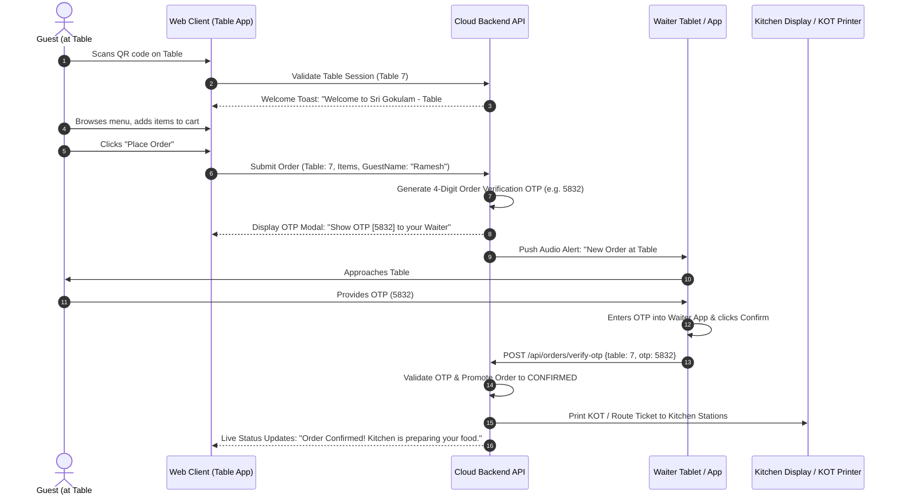
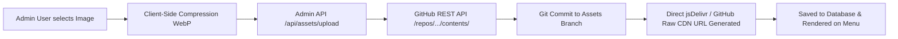
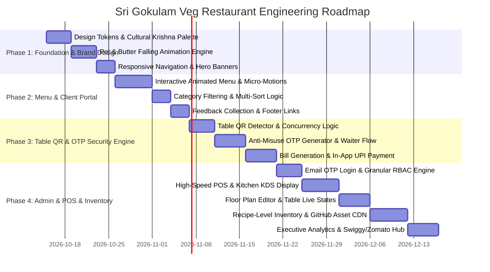

# Sri Gokulam Veg Restaurant (Karaikudi)
## Comprehensive Architecture, Engineering & Business Master Plan

---

### Executive Overview

* **Brand Name**: Sri Gokulam Veg Restaurant
* **Location**: Karaikudi, Chettinad Region, Tamil Nadu
* **Cuisine Specialization**: Authentic Pure Vegetarian Chettinad Delicacies, Sattvic & Traditional Tamil Nadu Dining, South Indian Tiffin, Filter Coffee & Traditional Sweets.
* **Core Technological Objective**: A unified, high-performance web platform featuring an experiential client portal, a zero-friction QR-based table ordering lifecycle with tamper-proof OTP staff confirmation, and an enterprise-grade restaurant back-office administration suite (POS, KOT, CRM, KDS, Floor Management, Recipe-level Inventory, and GitHub-backed Asset CDN).
* **Technology Partner**: **AJ Tech Solutions** ([https://ajtechsolutions.netlify.app/](https://ajtechsolutions.netlify.app/))
* **Lead System Architect & Developer Admin**: Aswin

---

## 1. Brand Identity & Visual Design System

### 1.1 Palette & Color Tokens (Lord Krishna Divine Blue & Traditional Tamil Nadu)
The visual identity harmonizes the sacred shades of Lord Krishna (*Gokulam*, *Mayil Peeli* - Peacock Feather, *Ven-Vennai* - Pure Butter) with the regal architectural heritage of Chettinad mansions (*Athangudi* tiles, teak pillars, polished brass lamps, and fresh banana leaves).

```css
:root {
  /* Primary Divine Blue Shades (Lord Krishna Motif) */
  --color-krishna-blue-900: #061e38;  /* Deep temple midnight blue */
  --color-krishna-blue-800: #0a2d54;  /* Royal Gokulam blue */
  --color-krishna-blue-700: #104179;  /* Krishna primary brand blue */
  --color-krishna-blue-600: #1a5ca6;  /* Interactive sapphire accent */
  --color-krishna-blue-100: #e8f1fa;  /* Sky tint background */
  --color-krishna-blue-50:  #f4f8fd;  /* Subtle section background */

  /* Pure Butter & Milk Tones */
  --color-butter-cream:     #fffdf7;  /* Fresh churned butter cream */
  --color-butter-gold:      #f5b738;  /* Cow ghee / butter drop gold */
  --color-milk-white:       #ffffff;  /* Sacred clean background */
  --color-surface-pure:     #ffffff;

  /* Traditional Tamil Nadu & Chettinad Accents */
  --color-brass-kuthu:      #c59b27;  /* Antique brass oil lamp tone */
  --color-terracotta:       #b85d38;  /* Athangudi terracotta red */
  --color-banana-leaf:      #2d7a3a;  /* Fresh plantain leaf green */
  --color-kolam-sand:       #efe9dc;  /* Rice flour kolam off-white */

  /* Neutral Typography & Dark Shades */
  --color-text-primary:     #111927;  /* High contrast charcoal */
  --color-text-secondary:   #4b5565;  /* Muted slate */
  --color-text-light:       #9aa4b2;
  --color-border-subtle:    #e3e8ef;

  /* Elevation Shadows & Glassmorphism */
  --shadow-krishna-glow:    0 8px 32px 0 rgba(16, 65, 121, 0.14);
  --shadow-card-elevated:   0 12px 28px -4px rgba(10, 45, 84, 0.08);
  --glass-surface:          rgba(255, 255, 255, 0.88);
  --glass-border:           1px solid rgba(255, 255, 255, 0.6);
}
```

### 1.2 Typography & Aesthetics
* **Headings**: `Cinzel Decorative` / `Playfair Display` paired with `Cinzel` or Tamil script font `Mukta Malar` / `Anek Tamil` for authentic cultural heritage.
* **Body & UI**: `Plus Jakarta Sans` or `Inter` for hyper-legible, lightning-fast rendering on mobile displays.
* **Cultural Design Motifs**:
  * Athangudi floral floor tile borders as subtle geometric separators.
  * Gold brass filigree accents framing meal thali photos.
  * Subtle Kolam (Rangoli) vector patterns as watermarks in section headers.

---

## 2. Interactive Client Website Architecture

```
[Client Landing Page]
   ├── 1. Pot & Churned Butter Falling Animation (Interactive Preloader)
   ├── 2. Divine Krishna Blue & Traditional Heritage Navbar
   ├── 3. Dynamic Moving Hero Banner (Karaikudi Specialties & Ambience)
   ├── 4. Experiential Animated Menu (Sizzling Dosai, Sambar Cascade, Filter Coffee Vapor)
   ├── 5. Category Filters & Multi-Dimensional Sort Engine
   ├── 6. Table QR Experience Portal (Instant Table Detection & Welcome Toast)
   ├── 7. Cultural Story & Chettinad Veg Heritage Showcase
   ├── 8. Verified Guest Feedback & Rating System
   └── 9. Heritage Footer (Contact, Map, Timings, & AJ Tech Solutions Attribution)
```

### 2.1 The Signature Preloader: "Vennai Thaazhi" (Pot Butter Falling Animation)
* **Visual Concept**: A traditional earthenware Krishna mud pot (*Vennai Panai*) suspended gracefully at top-center.
* **Animation Sequence**:
  1. Handcrafted clay pot tilts gently with subtle physics wobble.
  2. A thick, glossy golden butter dollop (*Vennai thuli*) detaches with authentic viscous stretch (SVG cubic-bezier or Lottie droplet).
  3. The butter drop falls smoothly onto a lotus leaf or brass bowl below, creating a gentle ripple effect that transitions into the brand logo: **"Sri Gokulam Veg Restaurant"**.
  4. Percentage loading indicator smoothly counts `0% -> 100%` with warm Tamil typography: *ஆனந்தமான உணவின் தொடக்கம்* (*The start of blissful dining*).
  5. The preloader dissolves via CSS radial mask reveal to expose the Hero Section.

### 2.2 Moving Hero Banners (Dynamic Heritage Carousel)
* **Motion Behavior**: Auto-advancing parallax slider with touch-swipe support for mobile guests. Smooth Ken Burns zooming on background imagery with floating typography.
* **Curated Banner Slides**:
  * **Slide 1**: *The Crown of Karaikudi Vegetarian Dining* — Heritage Chettinad thali served on fresh tender plantain leaves.
  * **Slide 2**: *Gokulam's Golden Crispy Ghee Roast* — Piping hot dosai roasted in pure cow ghee with trio chutneys and shallot sambar.
  * **Slide 3**: *Authentic Kumbakonam Degree Filter Coffee* — Frothing brass dabarah set with aromatic steam rising in micro-motion.
  * **Slide 4**: *Reserve Your Family Feast* — Warm Chettinad courtyard dining hall welcoming families and travelers.

### 2.3 Experiential Menu with Micro-Motion & Live Action Elements
Instead of static flat images, each hero dish incorporates dynamic motion elements:
* **Ghee Podi Dosa**: Interactive hover/tap triggers steam particles and a micro-video snippet of ghee sizzling over golden crisp crust.
* **Thattu Vadai Sambar**: Visual loop showing aromatic drumstick sambar gently cascading over steaming fluffy button idlis.
* **Karaikudi Kuzhi Paniyaram**: Golden spheres frying with gentle sizzling oil bubble animation.
* **Special Chettinad Veg Biryani**: Fragrant Seeraga Samba rice with fried cashews and mint leaves gently falling into the handi.
* **Degree Filter Coffee**: Endless soothing loop of milk poured from height, creating rich golden crema froth.

### 2.4 Menu Category Filtering & Smart Sort Logic
* **Categories**:
  * `Traditional Tiffin (காலை / இரவு சிற்றுண்டி)`: Idli varieties, Ghee Roasts, Ravai Dosai, Poori Masala.
  * `Chettinad Veg Curries & Gravies`: Chettinad Ennai Kathirikai, Poondu Kuzhambu, Paneer Chettinad, Urulai Roast.
  * `Gokulam Special Full Meals (மதிய சாப்பாடு)`: Unlimited South Indian Raja Thali, Mini Meals, Quick Lunch.
  * `Variety Rice & Biryani`: Seeraga Samba Veg Biryani, Lemon Sevai, Curd Rice with Mor Milagai.
  * `Evening Savories & Snacks`: Medhu Vadai, Vazhaipoo Vadai, Kuzhi Paniyaram, Bajji Platter.
  * `Traditional Sweets & Desserts`: Gokulam Vennai Paal Payasam, Asoka Halwa, Elaneer Payasam.
  * `Beverages & Filter Coffee`: Kumbakonam Degree Coffee, Karupatti Tea, Jil Jil Jigarthanda, Fresh Butter Milk.
* **Sorting Capabilities**:
  * *Popularity / Chef's Recommendation*
  * *Price: Low to High / High to Low*
  * *Spice Level: Mild / Medium / Traditional Chettinad Fiery*
  * *Special Dietary Badges*: Jain (No Onion/Garlic), High Protein, Kid-Friendly, Gluten-Free.

---

## 3. QR Table Ordering Engine & Anti-Fraud Security Workflow

### 3.1 The Table Ordering Challenge & Anti-Misuse Architecture
In typical open QR menu systems, mischievous customers or internet users scanning leaked QR codes can trigger fake orders that waste food and kitchen labor. Sri Gokulam uses a **Two-Factor Table Order Verification System (OTP Protocol)**.



### 3.2 Step-by-Step Table Ordering Lifecycle

#### Step 1: Scan & Immediate Table Initialization
* The guest scans a durable acrylic QR standee placed on the table (`https://srigokulam.com/table/7?hash=a7b8f9`).
* The web app instantly detects Table #07, verifies its cryptographic hash to prevent tampering, and displays a customized greeting:
  > **"வணக்கம்! Welcome to Sri Gokulam Veg Restaurant - Table #07"**

#### Step 2: Multi-Party Concurrent Ordering on the Same Table
* Multiple guests seated at the same table (e.g., family or colleagues) may scan the table QR individually.
* To prevent confusion, the system prompts: *"Please enter your Name or Nickname (e.g., Karthik, Uncle, Mom)"*.
* When Guest A (Karthik) orders *Ghee Roast* and Guest B (Anand) orders *Meals + Payasam*, both orders append into **Table #07's Master Tab**, tagged distinctly with individual sub-KOT IDs and guest names:
  * `KOT-07-A [Karthik]`: 1x Ghee Podi Roast (Crispy)
  * `KOT-07-B [Anand]`: 1x Chettinad Special Meals, 1x Elaneer Payasam
* The kitchen and serving staff see exactly who ordered what, ensuring effortless food delivery to the right seat.

#### Step 3: Anti-Misuse OTP Order Authorization
* When the guest hits **"Confirm My Order"**, the order is placed into a `PENDING_VERIFICATION` state.
* The customer's mobile screen locks onto a prominent card:
  > **Order Verification OTP: [ 7 4 1 9 ]**  
  > *Please share this OTP with your server to start preparation.*
* An audible chime sounds on the Captain/Waiter mobile device: *"Table 7 placed an order (OTP: 7419)"*.
* The assigned floor waiter walks to Table 7, greets the guest, cross-checks special instructions (e.g., "extra crisp", "less spicy"), enters/scans the OTP into their staff app, and taps **Authorize**.
* **Result**: Zero unauthorized or prank orders reach the kitchen. Food waste is eliminated.

#### Step 4: Continuous Re-Ordering (Add More Items)
* At any point during dining, the guest can tap **"Order More Items"** on their mobile screen.
* Guests can add extra hot idlis, drinks, or desserts.
* The assigned waiter can also directly add items to the table's active tab from the staff handheld POS.
* Each re-order generates an append KOT (`KOT-07-C`), instantly relaying to the kitchen without altering the primary table bill.

#### Step 5: Bill Generation & Online Payment Unlock
* When guests finish eating, either the guest taps **"Request Final Bill"** or the waiter taps **"Generate Bill"** on their handheld terminal.
* Once the bill is generated:
  1. The **Online Payment Gateway** (UPI Intent, Google Pay, PhonePe, Paytm, Credit/Debit Cards) unlocks directly on the customer's QR web screen.
  2. The guest can pay immediately from their seat without waiting for the physical credit card machine.
  3. Digital itemized receipt with GST breakup is displayed and can be saved to WhatsApp or downloaded as a PDF.
  4. The moment payment is verified via Webhook, the table status in the Admin Floor Plan automatically updates to `CLEANING_REQUIRED`, and once cleaned, returns to `AVAILABLE/FREE`.

#### Step 6: Counter Cashier Settlement (Offline Alternate)
* If the guest prefers paying at the cash counter:
  1. The guest walks to the cashier with their Table Number (#07) or Bill Number.
  2. The cashier enters Table #07 or KOT Number into the POS terminal.
  3. The full aggregated bill appears with real-time sync.
  4. The cashier collects Cash, Card, or swipe machine payment and marks the bill **Paid**.
  5. The customer's phone screen automatically updates: *"Bill Settled at Counter. Thank you for dining at Sri Gokulam!"*

---

## 4. Guest Mode vs. Phone OTP Login & Loyalty Infrastructure

* **Zero-Friction Default (Guest Mode)**: No registration or app download needed. Visitors can browse, view animations, scan tables, and place orders in 100% Guest Mode.
* **Optional Phone OTP Login**:
  * Guests can log in with their 10-digit Indian mobile number via instant SMS OTP.
  * **Benefits Unlocked**:
    * View past orders and favorite dishes.
    * 1-Click "Re-order my regular breakfast".
    * Track accumulated Gokulam Reward Points (e.g., 5% cashback points redeemable on future visits).
    * Birthday and anniversary special surprises.

---

## 5. Post-Dining Customer Feedback & Reputation Engine

* Immediately upon bill settlement, a high-converting, friendly feedback card renders on the guest's phone:
  * **Food Taste & Authenticity** (1-5 Star Rating with animated emoji feedback).
  * **Service Speed & Waiter Courtesy** (1-5 Stars).
  * **Cleanliness & Ambience** (1-5 Stars).
  * **Quick Tag Pills**: *"Crispy Dosai", "Authentic Sambar", "Quick Service", "Filter Coffee Superb", "Child Friendly"*.
  * **Comments / Suggestions Box**: Direct feedback to the Owner/Super Admin.
  * **Smart Google Review Booster**: If the guest gives a 5-Star rating, a gentle prompt appears: *"We are delighted you loved our food! Would you take 10 seconds to share this on Google Maps?"* with a direct 1-tap link to Sri Gokulam's Google Business profile.

---

## 6. Footer & Brand Compliance

* **Mandatory Technical Attribution**:
  * Clean, elegant typography at the bottom of every page:
  * Text: `Designed & Developed with excellence by AJ Tech Solutions`
  * Active hyperlink: [https://ajtechsolutions.netlify.app/](https://ajtechsolutions.netlify.app/)
* **Footer Sections**:
  * *Column 1*: Sri Gokulam Veg Restaurant — Pure Vegetarian Chettinad Delicacies. FSSAI License Number, Pure Sattvic Kitchen Promise.
  * *Column 2*: Quick Links (Menu, Story, Table QR Portal, Banquet/Catering Inquiry, Gift Cards).
  * *Column 3*: Contact & Hours (Breakfast 7:00 AM - 11:00 AM, Lunch 12:00 PM - 3:30 PM, Tiffin & Dinner 6:30 PM - 10:30 PM. Karaikudi, Tamil Nadu).
  * *Column 4*: Social Media links (Instagram, Facebook, YouTube) and WhatsApp Quick Chat.

---

## 7. Comprehensive Admin Panel Architecture

```
[Admin Management Suite]
   ├── 1. Authentication & Security Gateway (Email OTP + Granular RBAC)
   ├── 2. Live Floor Plan & Visual Table Management
   ├── 3. Live Order Pipeline (Kanban: Dine-in, Takeaway, Online Delivery)
   ├── 4. POS Billing & High-Speed Thermal Printing
   ├── 5. Kitchen Display System (KDS) & Multi-Station KOT Dispatch
   ├── 6. Dynamic Menu & Category Master (CRUD Engine)
   ├── 7. GitHub Repository Direct Asset Management (CDN Engine)
   ├── 8. Real-Time Recipe-Level Inventory & Food Costing
   ├── 9. Customer Relationship Management (CRM) & Loyalty
   ├── 10. Executive Analytics & Performance Dashboard
   └── 11. Developer Admin Hub (Feature Flags, Maintenance, Integrations)
```

### 7.1 Multi-Tier Role-Based Access Control (RBAC) & Secure Login

#### Login Protocol
* Staff and administrators log in securely using their registered email address.
* The system dispatches a high-entropy 6-digit Email OTP valid for 5 minutes, preventing stolen password vulnerabilities.

#### Granular Permissions Matrix

| Module / Feature | Developer Admin (Aswin) | Super Admin (Owner) | Store Manager | Cashier | Waiter / Captain | Kitchen Staff |
| :--- | :---: | :---: | :---: | :---: | :---: | :---: |
| **System Maintenance Mode** | ✅ Full Control | ❌ No Access | ❌ No Access | ❌ No Access | ❌ No Access | ❌ No Access |
| **Feature Unlock/Lock Flags** | ✅ Full Control | ❌ No Access | ❌ No Access | ❌ No Access | ❌ No Access | ❌ No Access |
| **Create Super Admin** | ✅ Full Control | ❌ No Access | ❌ No Access | ❌ No Access | ❌ No Access | ❌ No Access |
| **Financial / Profit Margins** | ✅ View / Debug | ✅ Full Access | ⚠️ Limited | ❌ No Access | ❌ No Access | ❌ No Access |
| **Menu CRUD & Pricing** | ✅ Full Control | ✅ Full Control | ✅ Edit Items | ❌ View Only | ❌ View Only | ❌ View Only |
| **Inventory & Supplier POs** | ✅ Full Control | ✅ Full Control | ✅ Full Access | ❌ No Access | ❌ No Access | ⚠️ Consumption |
| **Floor Plan & Table Config** | ✅ Full Control | ✅ Full Control | ✅ Full Access | ⚠️ View Only | ⚠️ View Only | ❌ No Access |
| **Order OTP Verification** | ✅ Debug Mode | ✅ Full Access | ✅ Full Access | ✅ Full Access | ✅ Full Access | ❌ No Access |
| **POS Billing & Settlements** | ✅ Debug Mode | ✅ Full Access | ✅ Full Access | ✅ Full Access | ❌ No Access | ❌ No Access |
| **Kitchen Display (KDS)** | ✅ Debug Mode | ✅ Full Access | ✅ Full Access | ❌ No Access | ⚠️ View Status | ✅ Full Access |
| **Customer Feedback & CRM** | ✅ Full Control | ✅ Full Control | ✅ View & Act | ❌ No Access | ❌ No Access | ❌ No Access |

> **Developer Admin Privilege**: Aswin retains the root developer console to manage environment parameters, database backups, API rate limits, feature flags (e.g., toggling Swiggy/Zomato or WhatsApp modules), and creating/monitoring Super Admin profiles.

---

### 7.2 Point of Sale (POS) & Smart Billing Engine
* **High-Speed Billing**: Engineered for peak South Indian morning tiffin and lunch rush hours. Complete bill generation in under 3 keystrokes.
* **Thermal Printer Integration**:
  * Direct 1-click printing to standard 80mm and 58mm thermal receipt printers via WebUSB / ESC/POS protocol or network print server.
  * Custom Tamil & English bilingual receipt formatting with restaurant logo, GSTIN, FSSAI, itemized breakup, CGST/SGST breakdown, and footer greetings.
* **KOT-to-Bill Reconciliation**:
  * The cashier can pull up any table tab, inspect all associated sub-KOTs, apply manager-approved discounts (percentage or fixed amount with mandatory reason logging), and split bills by item or seat.
* **Payment Multi-Modal Gateway**:
  * Split payments supported: e.g., ₹500 Cash + ₹750 UPI.

---

### 7.3 Kitchen Display System (KDS) & Multi-Station KOT Routing
* Large screen interface mounted in kitchen prep zones.
* **Station-Wise Routing Engine**:
  * *Tiffin Station 1*: All dosai, idli, vadai, poori items.
  * *Meals & Gravy Station 2*: Rice, sambar, vathal kuzhambu, poriyal, kootu.
  * *Beverage & Tea Counter 3*: Filter coffee, tea, juices, payasam.
* **Status Lifecycles**:
  * `NEW` (Flashing Red with periodic bell chime until acknowledged).
  * `PREPARING` (Orange - timer shows prep elapsed time in minutes).
  * `READY TO SERVE` (Green - alerts assigned floor waiter on their device).
  * `SERVED` (Archived with fulfillment metrics).

---

### 7.4 Live Order Management (Visual Kanban Pipeline)
A real-time command center managing all three order streams:
1. **Dine-In (Table QR & Captain Orders)**
2. **Takeout / Parcel Counter**
3. **Home Delivery Orders**

* **Kanban Columns**: `Incoming Pending` ➜ `Kitchen Preparing` ➜ `Ready for Pickup / Waiter Dispatch` ➜ `Out for Delivery` ➜ `Completed / Settled`.
* **Audible Alerts**: Custom sound notifications (distinct chimes for dine-in OTP verification vs. incoming delivery orders).
* **1-Click Thermal KOT & Parcel Label Print** from any card in the pipeline.

---

### 7.5 Interactive Floor Plan & Table Management
* **Visual Drag-and-Drop Floor Plan**:
  * Configurable layout representing Sri Gokulam's actual Karaikudi restaurant architecture: Ground Floor Family Dining, AC Hall, Traditional Veranda Seating.
* **Dynamic Table States**:
  * 🟢 **Available (Green)**: Empty, sanitized, ready for seating.
  * 🟡 **Occupied / Dining (Amber)**: Active order ongoing, timer shows occupancy duration.
  * 🔵 **Bill Printed / Payment Pending (Blue)**: Guests finished eating, bill generated.
  * 🔴 **Cleaning / Turnover (Red)**: Table vacate detected, busboy dispatched for cleaning.
  * ⚪ **Reserved (Gray)**: Booked for upcoming time slot.
* **Waitlist & Table Blocking**:
  * Quick guest token queueing during weekend festival rushes with estimated wait times sent to customer phones.
  * 1-click blackout of tables for deep cleaning, private banquets, or maintenance.

---

### 7.6 Real-Time Recipe-Level Inventory & Food Costing
Sri Gokulam's inventory avoids generic stock logs by linking directly to dish recipes (Bill of Materials - BOM).

* **Recipe Consumption Logic**:
  * When 1x *Ghee Podi Dosa* is marked `PREPARING` in KDS:
    * Dosa Batter: -180 grams
    * Pure Cow Ghee: -25 ml
    * Idli Podi: -20 grams
    * Coconut Chutney: -50 grams
    * Sambar: -100 ml
* **Real-Time Stock Thresholds & Alerts**:
  * Configurable safety stock triggers: When Cow Ghee falls below 5 Liters or Dosa Batter below 10 kg, an instant red alert banners the Store Manager's dashboard.
* **Supplier & Purchase Order (PO) Management**:
  * Supplier directories (Local Karaikudi rice mills, dairy vendors, spice merchants).
  * Auto-generation of purchase orders with PDF export.
* **Wastage & Spoilage Auditing**:
  * Daily recording of vegetable trims, expired milk, or returned food items with root cause categorization (Prep error, Spoiled, Overcooked) to safeguard profit margins.

---

### 7.7 GitHub Repository Direct Asset Management Engine
To eliminate expensive monthly AWS S3 / Cloudinary hosting fees, the admin panel features a direct integration with a designated GitHub Repository.



* **Workflow**:
  1. Admin selects a high-resolution food photo (e.g. *Karupatti Coffee.jpg*).
  2. Client-side browser automates lossless WebP compression and generates thumbnail variants.
  3. The backend calls the GitHub Contents API (`PUT /repos/{owner}/{repo}/contents/{path}`) with a dedicated fine-grained personal access token.
  4. The file commits directly to an `assets` repository (e.g., `sri-gokulam-assets/menu/tiffin/`).
  5. The API receives the committed commit hash and produces a high-speed CDN URL (via `raw.githubusercontent.com` or `cdn.jsdelivr.net/gh/...`).
  6. The public URL automatically binds to the menu item in the database.

---

### 7.8 Customer Relationship Management (CRM) & Analytics
* **Guest Profiles**: Auto-compiled via phone numbers collected from OTP logins and bill receipts.
* **Metrics Tracked**: Total lifetime visits, favorite ordered dishes, average order value (AOV), last dining date.
* **Segmentation**:
  * *VIP Regulars* (Dined > 5 times a month)
  * *Breakfast Lovers* (Primary morning visitors)
  * *Inactive Guests* (Haven't visited in 45 days)
* **Feedback Intelligence**: Real-time sentiment analysis flagging any rating < 3 stars directly to the Managing Director's phone for immediate resolution.

---

### 7.9 Executive Analytics & Performance Reporting
* **Key Executive Metrics**:
  * Daily, Weekly, Monthly Gross & Net Revenue.
  * Average Table Turnover Time (Target: 28-35 minutes for tiffin, 45 minutes for meals).
  * Top-10 Best-Selling Items by Volume and Contribution Margin.
  * Hourly Rush Heatmap (identifying Karaikudi morning school/office peaks & evening dinner surges).
  * Wastage percentage relative to overall raw material expenditure (Target: < 2.5%).
  * Waiter Service Velocity (Average time from OTP confirmation to food serving).

---

### 7.10 System Integration Hub & Future Roadmap
* **Third-Party Delivery Aggregators (Swiggy / Zomato)**:
  * Ready webhook interface architecture to accept Swiggy and Zomato incoming delivery orders directly into the unified KDS without maintaining multiple vendor tablets.
  * Unified menu sync button (updates pricing and stock status on Swiggy/Zomato in one tap).
* **WhatsApp Business Automation (Coming Soon Banner)**:
  * Architecture designed for Meta Cloud WhatsApp API:
    * Instant bill receipt PDF delivery to customer's WhatsApp.
    * Automated notification when reserved table is ready.
    * Weekly weekend special menu broadcasts.

---

## 8. Relational Data Architecture (Database Schema)

```
+------------------+         +--------------------+         +-------------------+
|      tables      | 1     * |   table_sessions   | 1     * |      orders       |
+------------------+---------+--------------------+---------+-------------------+
| id (PK)          |         | id (PK)            |         | id (PK)           |
| table_number     |         | table_id (FK)      |         | session_id (FK)   |
| section          |         | session_token      |         | guest_name        |
| seating_capacity |         | status             |         | status            |
| qr_code_hash     |         | created_at         |         | verification_otp  |
+------------------+         +--------------------+         | verified_by (FK)  |
                                                            +-------------------+
                                                                      | 1
                                                                      | *
+------------------+         +--------------------+         +-------------------+
|    menu_items    | 1     * |    order_items     | *     1 |       kots        |
+------------------+---------+--------------------+---------+-------------------+
| id (PK)          |         | id (PK)            |         | id (PK)           |
| name_en          |         | order_id (FK)      |         | order_id (FK)     |
| name_ta          |         | menu_item_id (FK)  |         | kot_number        |
| category_id (FK) |         | quantity           |         | station           |
| base_price       |         | item_price         |         | status            |
| image_url (GH)   |         | special_notes      |         | created_at        |
| is_available     |         +--------------------+         +-------------------+
+------------------+
        | 1
        | *
+------------------+
|  recipe_items    |
+------------------+
| id (PK)          |
| menu_item_id(FK) |
| inventory_id(FK) |
| quantity_used    |
+------------------+
```

### 8.1 Core Entities & Fields

#### 1. `tables` & `table_sessions`
* `tables`: `id`, `table_number` (VARCHAR), `section` (AC_HALL, GROUND_FLOOR, VERANDA), `capacity` (INT), `qr_code_hash` (VARCHAR), `status` (AVAILABLE, OCCUPIED, BILL_GENERATED, CLEANING).
* `table_sessions`: `id`, `table_id` (FK), `session_token` (UUID), `active_guest_count` (INT), `opened_at` (TIMESTAMP), `closed_at` (TIMESTAMP).

#### 2. `orders` & `order_items`
* `orders`: `id`, `session_id` (FK), `guest_name` (VARCHAR), `verification_otp` (CHAR 4), `status` (PENDING_OTP, VERIFIED, IN_KITCHEN, SERVED, CANCELLED), `verified_by_staff_id` (FK to `users`), `created_at` (TIMESTAMP).
* `order_items`: `id`, `order_id` (FK), `menu_item_id` (FK), `quantity` (INT), `unit_price` (DECIMAL), `notes` (TEXT).

#### 3. `kots` (Kitchen Order Tickets)
* `id`, `order_id` (FK), `kot_number` (e.g. `KOT-07-001`), `station` (TIFFIN, MEALS, BEVERAGES), `status` (NEW, PREPARING, READY, SERVED), `dispatched_at` (TIMESTAMP).

#### 4. `bills` & `transactions`
* `bills`: `id`, `session_id` (FK), `bill_number` (e.g. `SGR-2026-0892`), `subtotal` (DECIMAL), `discount_amount` (DECIMAL), `cgst` (DECIMAL), `sgst` (DECIMAL), `total_amount` (DECIMAL), `payment_status` (PENDING, PAID, REFUNDED), `settlement_mode` (CASH, ONLINE_UPI, CARD, SPLIT).

#### 5. `inventory_items`, `recipe_items` & `wastage_logs`
* `inventory_items`: `id`, `ingredient_name` (e.g., *Cow Ghee, Ponni Rice, Mustard, Small Onion*), `unit` (KG, LTR, GM, ML), `current_stock` (DECIMAL), `low_stock_threshold` (DECIMAL), `cost_per_unit` (DECIMAL).
* `recipe_items`: `id`, `menu_item_id` (FK), `inventory_item_id` (FK), `quantity_required` (DECIMAL).
* `wastage_logs`: `id`, `inventory_item_id` (FK), `quantity` (DECIMAL), `reason` (EXPIRED, SPOILED, PREP_LOSS), `reported_by` (FK), `created_at` (TIMESTAMP).

#### 6. `users` & `staff_profiles`
* `id`, `full_name`, `email` (Unique), `phone` (Unique), `role` (`DEVELOPER_ADMIN`, `SUPER_ADMIN`, `STORE_MANAGER`, `CASHIER`, `WAITER`, `KITCHEN`), `is_active` (BOOL), `otp_hash`, `otp_expires_at`.

#### 7. `feedbacks`
* `id`, `session_id` (FK), `guest_phone`, `food_rating` (1-5), `service_rating` (1-5), `ambience_rating` (1-5), `tags` (JSON ARRAY), `comment` (TEXT), `created_at`.

---

## 9. Technology Stack & Architecture Implementation Blueprint

| Layer | Recommended Technology | Architectural Rationale |
| :--- | :--- | :--- |
| **Frontend Web App** | **Next.js 15 / React 19** with Tailwind CSS & Vanilla CSS Design Tokens | Server-Side Rendering (SSR) for instant SEO in Karaikudi local search, mobile-first responsive layout, and app-like performance. |
| **Styling & Motion** | **Vanilla CSS + Framer Motion / Lottie** | Ultra-smooth 60fps butter droplet animation, liquid steam particle loops, and responsive Chettinad aesthetics. |
| **Backend & Realtime** | **Node.js (Express / Fastify) or Next.js Route Handlers** with **WebSockets (Socket.io)** | Instant sub-100ms real-time event broadcasting for table orders, waiter buzzers, and KDS status changes. |
| **Primary Database** | **PostgreSQL (Supabase or Neon Serverless)** | Relational integrity for financial bills, multi-table transactions, and ACID-compliant stock deductions. |
| **Asset CDN Storage** | **GitHub Repository Contents API** | Free, permanent, versioned cloud image asset hosting directly integrated into the admin dashboard. |
| **Authentication** | **Zero-Password Email / SMS OTP** (via Resend / Twilio) + JWT & HTTP-Only Secure Cookies | Impenetrable security with role-based claim authorization; eliminates forgotten staff passwords. |
| **Printing Protocol** | **WebUSB / ESC/POS Network Driver** | Direct 1-click thermal printing from desktop or mobile tablets without messy browser print dialogs. |

---

## 10. Step-by-Step Implementation Roadmap



### Milestone Deliverables

#### Milestone 1: Experience & Brand Immersion (Weeks 1-2)
* Complete visual identity setup (Krishna Blue, Athangudi accents, butter tones).
* Realization of the signature **Vennai Thaazhi** (Pot & Butter Falling) preloader animation.
* Parallax moving hero carousel showcasing Karaikudi heritage.
* Interactive, animated food menu with micro-motion loops (sizzling dosai, sambar cascade, filter coffee vapor).

#### Milestone 2: Table QR & Security Engine (Weeks 3-4)
* Cryptographic Table QR generator and table detector.
* Multi-party table ordering with guest name and distinct sub-KOT assignment.
* Real-time OTP anti-fraud verification loop between guest phone and waiter app.
* Seamless re-ordering, waiter item addition, and instant in-seat UPI payment release upon billing.

#### Milestone 3: Back-Office Suite (POS, KDS, Floor Plan) (Weeks 5-6)
* Developer Admin console (Aswin) with feature toggles, maintenance mode, and Super Admin provisioning.
* High-speed POS billing engine with 80mm/58mm bilingual thermal receipt printing.
* Station-routed Kitchen Display System (KDS) with audio notifications.
* Interactive drag-and-drop Karaikudi dining hall floor plan.

#### Milestone 4: Operational Intelligence & Asset Engine (Weeks 7-8)
* Direct GitHub Repository asset upload engine for instant cloud menu photography.
* Automated recipe-level inventory deduction with safety stock alerts and wastage logs.
* Executive revenue, turnover, and staff performance dashboards.
* Third-party delivery hub integration points (Swiggy / Zomato) and WhatsApp receipt pipeline.
* Production deployment with AJ Tech Solutions footer compliance.

---

*Document prepared by AJ Tech Solutions for Sri Gokulam Veg Restaurant, Karaikudi.*
